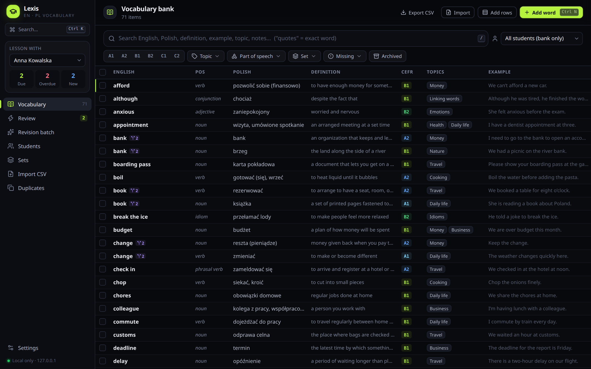
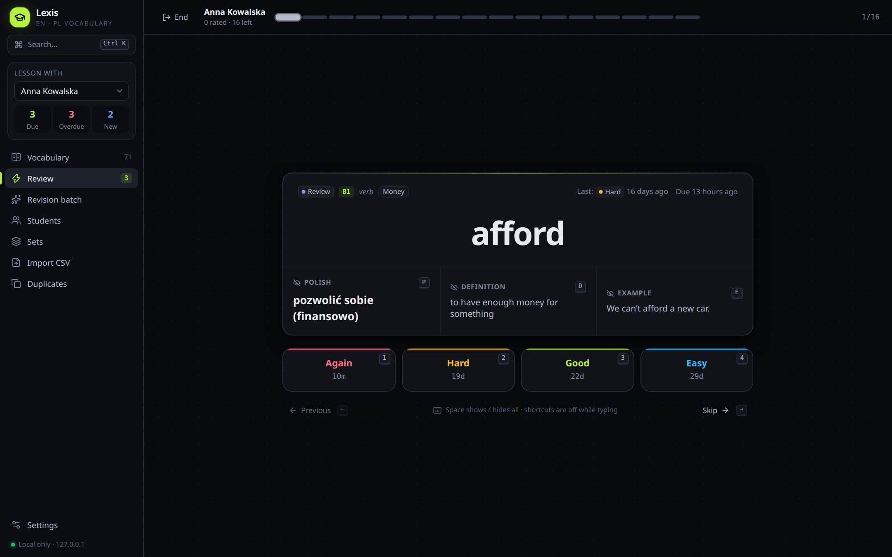
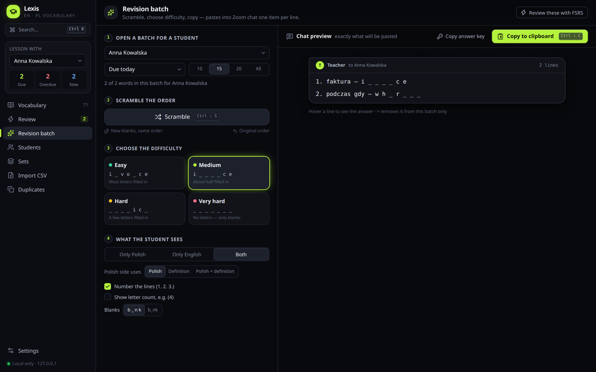
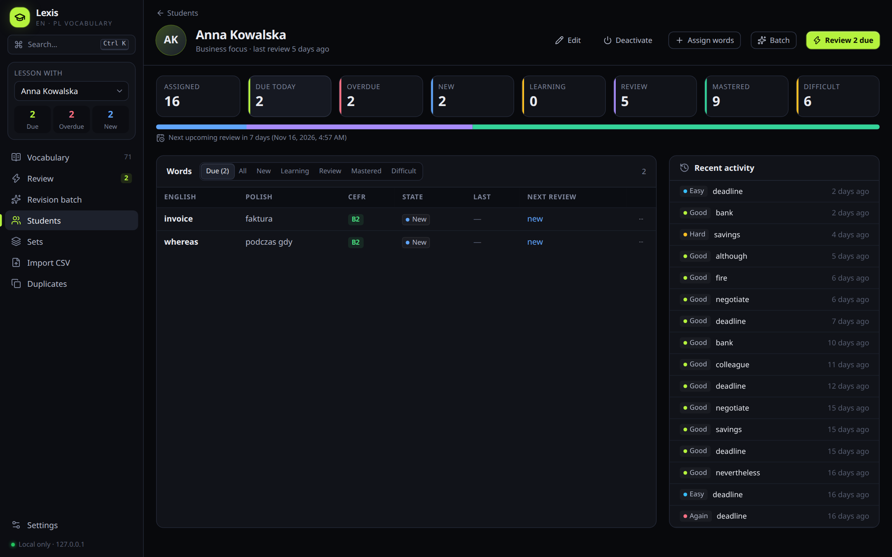
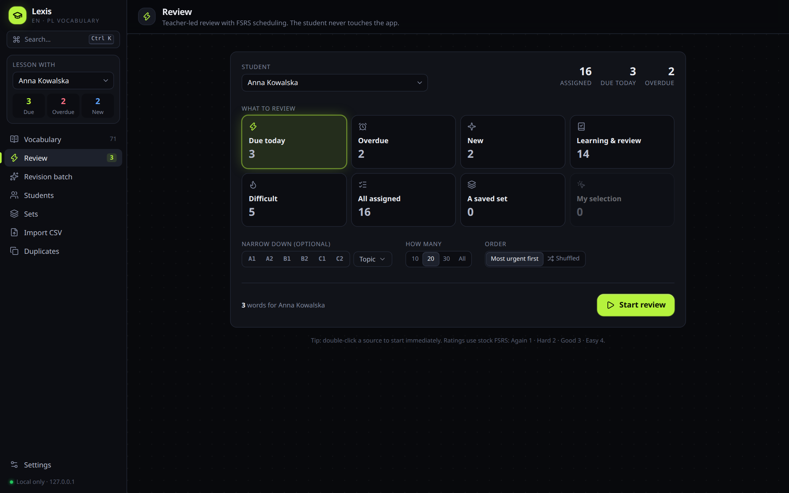
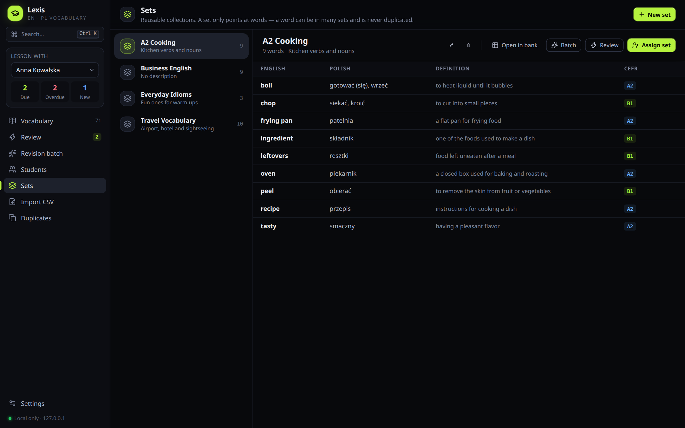
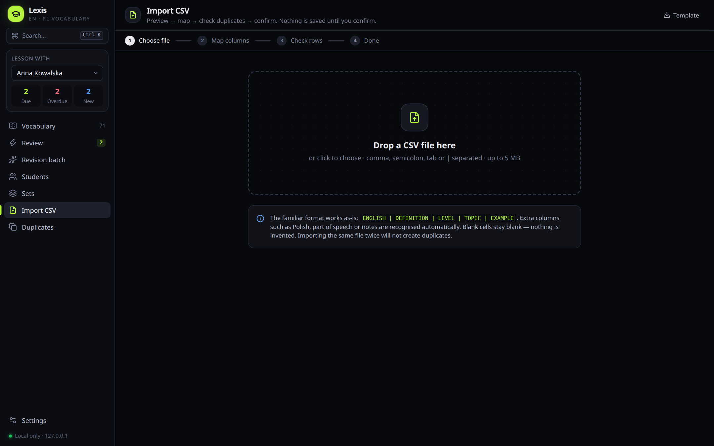
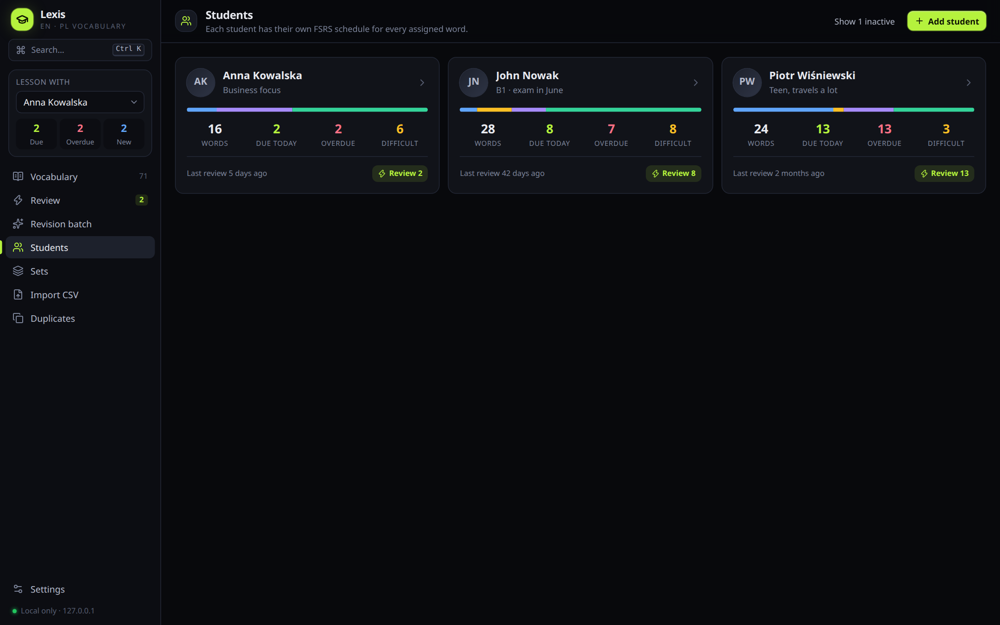
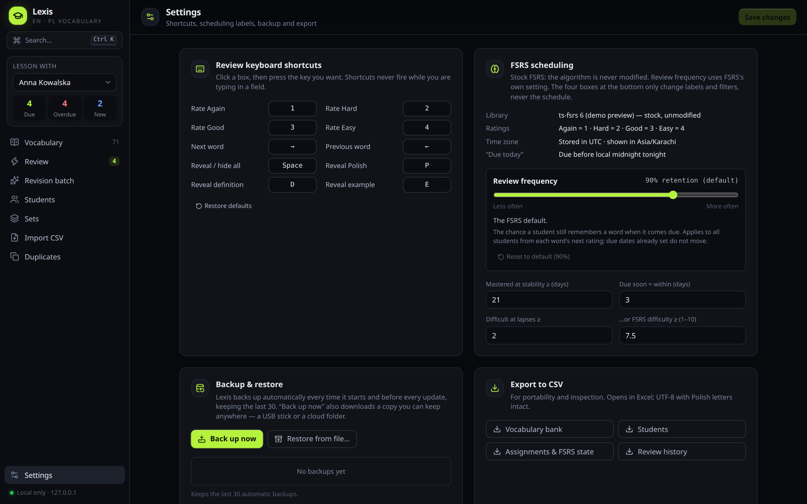
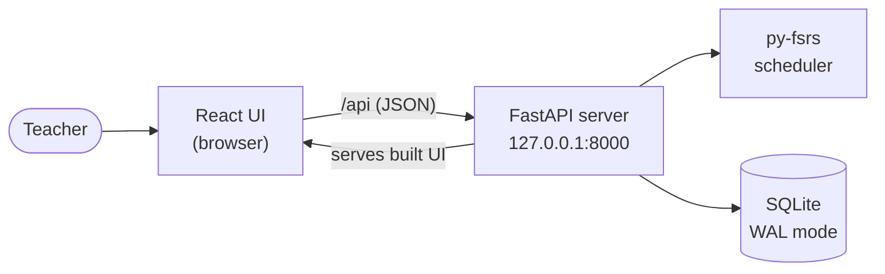

<div align="center">


# Lexis

**English–Polish vocabulary review for one-to-one teachers, with FSRS spaced repetition**

Keep one vocabulary bank, assign words to each student, run reviews together in a lesson, and paste
revision quizzes into Zoom chat. Everything runs on your own computer.




</div>

---

## Contents

- [Why Lexis](#why-lexis)
- [Features](#features)
- [Screenshots](#screenshots)
- [How it works](#how-it-works)
- [Tech stack](#tech-stack)
- [Getting started](#getting-started)
- [Tests and code style](#tests-and-code-style)
- [Windows build](#windows-build)
- [Project structure](#project-structure)
- [Privacy and security](#privacy-and-security)
- [Documentation](#documentation)
- [License](#license)

## Why Lexis

Flashcard apps are made for a learner studying alone. Lexis is made for a **teacher** running a live lesson with a
student: the teacher drives the review, the student answers out loud, and the
[FSRS](https://github.com/open-spaced-repetition/py-fsrs) algorithm decides when each word comes back, separately
for every student.

## Features

| | |
|---|---|
| 📚 **Vocabulary bank** | English, Polish, definition, example, CEFR level (A1–C2), part of speech, topics. Fast search (`"quotes"` for exact match), filters, bulk actions and a virtualised table that stays fast with thousands of words. |
| 🧑‍🎓 **Per-student progress** | Assign words or whole sets to each student. Each student gets their own FSRS schedule with due, overdue, new, learning, mastered and difficult counts, plus recent activity. |
| ⚡ **Teacher-led review** | Review what is due, overdue, new, difficult, a saved set or a hand-picked selection. Reveal Polish, definition and example one at a time and rate **Again · Hard · Good · Easy**. Each button shows when the word will come back. |
| 🧩 **Revision batches for Zoom** | Builds a numbered fill-in-the-blanks quiz (`i _ _ _ _ c e`) at four difficulty levels, scrambles the order, and copies it to the clipboard ready to paste into Zoom chat, with a separate answer key. |
| 🗂️ **Sets** | Reusable word lists (e.g. *Travel*, *Business English*). A set only points at words, so nothing is duplicated. |
| 📥 **CSV import** | A four-step wizard: choose file, map columns, check rows, done. Comma, semicolon, tab or pipe separators. Shows duplicates before anything is saved, and re-importing the same file creates no copies. |
| 🔁 **Duplicate finder** | Spots words entered twice and helps merge them. |
| ⌨️ **Keyboard first** | `Ctrl+K` search, `Ctrl+N` new word, `1–4` to rate, `Space` show/hide, `P` `D` `E` reveal fields. Shortcuts can be changed in Settings. |
| 💾 **Backup and restore** | One-click backup. Restore files are integrity-checked before use. Database migrations run automatically on update. |
| 🔒 **Offline and private** | No account, no cloud, no AI calls. Data stays on the teacher's PC. |

## Screenshots

<table>
  <tr>
    <td width="50%"><p align="center"><b>Review session</b>: reveal fields one by one, rate with FSRS</p></td>
    <td width="50%"><p align="center"><b>Revision batch</b>: fill-in-the-blanks quiz for Zoom chat</p></td>
  </tr>
  <tr>
    <td><p align="center"><b>Student progress</b>: FSRS states and recent activity</p></td>
    <td><p align="center"><b>Review setup</b>: choose what to review and how many</p></td>
  </tr>
  <tr>
    <td><p align="center"><b>Sets</b>: reusable word collections</p></td>
    <td><p align="center"><b>CSV import</b>: preview, map, check, confirm</p></td>
  </tr>
  <tr>
    <td><p align="center"><b>Students</b></p></td>
    <td><p align="center"><b>Settings</b>: shortcuts, backup and restore</p></td>
  </tr>
</table>

<sub>Screenshots use the built-in demo data (<code>npm run dev:mock</code>). The names are made up.</sub>

## How it works



1. The teacher adds words to the **bank** (by hand, by pasting from Excel, or by CSV import).
2. Words or whole **sets** are **assigned** to a student. Each assignment gets its own FSRS card.
3. In a lesson, the teacher starts a **review**. Each rating updates that student's card, and FSRS works out the next
   due date.
4. Between lessons, the teacher sends a **revision batch** to Zoom chat, then reviews those words with FSRS next time.

## Tech stack

| Layer | Technology |
|---|---|
| Backend | Python 3.12 · FastAPI · SQLAlchemy 2 · Alembic · **py-fsrs 6.3.2** · SQLite (WAL) · Uvicorn |
| Frontend | React 19 · TypeScript (strict) · Vite · Tailwind CSS 4 · TanStack Query / Table / Virtual · lucide-react · Papa Parse |
| Quality | pytest · Vitest · Ruff · Oxlint · Prettier |
| Packaging | PyInstaller · Inno Setup 6 (Windows installer), also buildable from Linux with Wine |

## Getting started

**Requirements:** Python 3.12, Node.js 20+

```bash
git clone https://github.com/Farhan1232/VocabReview.git
cd VocabReview

# backend
cd backend && python3.12 -m venv .venv && .venv/bin/pip install -r requirements.txt -r requirements-dev.txt

# frontend
cd ../frontend && npm ci

# build the UI and start the app at http://127.0.0.1:8000
cd .. && ./start-dev.sh
```

**UI development with hot reload:** start the backend (`cd backend && .venv/bin/python -m app --no-browser`), then
run `cd frontend && npm run dev` and open http://127.0.0.1:5173 (`/api` is proxied).

**Try the UI without a backend:** `cd frontend && npm run dev:mock` runs the whole interface on demo data.

Interactive API docs are at http://127.0.0.1:8000/api/docs while the server is running.

## Tests and code style

```bash
cd backend && .venv/bin/python -m pytest -q     # 47 API/acceptance tests (real SQLite + py-fsrs)
cd frontend && npm test                         # 47 unit tests (prefill, copy formats, search, CSV, duplicates, rules)
```

```bash
cd frontend && npm run lint && npm run format:check   # Oxlint and Prettier
cd backend && .venv/bin/ruff check . && .venv/bin/ruff format --check .
```

## Windows build

On a Windows PC with Python 3.12, Node 20+ and (optionally) Inno Setup 6:

```powershell
powershell -ExecutionPolicy Bypass -File packaging\build_windows.ps1
```

This produces `packaging\dist\Lexis\Lexis.exe` (portable) and `packaging\dist\LexisSetup-1.0.4.exe` (installer).

From Linux with Wine, `packaging/build_on_linux_wine.sh [work-dir]` produces the same two outputs in
`packaging/dist/`. It uses genuine Windows Python packages, runs the backend tests on Windows Python, and stops if
any Wine DLL got bundled.

The app icon is `packaging/lexis.ico`, exported from `packaging/lexis-icon.svg` (sizes above 32 px) and
`packaging/lexis-icon-small.svg` (32 px and below). The browser tab uses `frontend/public/favicon.svg` and
`favicon.ico`.

## Project structure

```
VocabReview/
├── backend/          FastAPI + SQLite + py-fsrs → serves /api and the built UI on 127.0.0.1:8000
│   ├── app/          API routes, models, FSRS scheduling, CSV import, backup/restore
│   ├── migrations/   Alembic migrations
│   └── tests/        pytest API and acceptance tests
├── frontend/         React + TypeScript UI (Vite) → built into frontend/dist
│   └── src/
│       ├── api/      typed API client + mock API with demo data
│       └── pages/    vocab, review, batch, students, sets, import, duplicates, settings
├── packaging/        Windows build (PyInstaller + Inno Setup installer), icons
├── docs/             USER_GUIDE.md (teacher) · TECHNICAL.md (developer) · screenshots
└── start-dev.sh      build the UI and run the app
```

## Privacy and security

- The server listens on **127.0.0.1 only**, so other computers on the network cannot connect.
- Requests from non-local clients, unexpected `Host` headers (DNS rebinding) and cross-site `Origin`s (CSRF) are
  refused.
- All SQL is parameterised, inputs are validated with Pydantic, and restore files are integrity-checked.
- No login by design (one teacher, one PC). Data lives in `%LOCALAPPDATA%\Lexis` on Windows.

## Documentation

- 📖 [Teacher's guide](docs/USER_GUIDE.md): install, backup and restore, everyday use, keyboard shortcuts
- 🛠️ [Technical documentation](docs/TECHNICAL.md): architecture, data model, FSRS, time zones, import/export,
  migrations

## License

Released under the [MIT License](LICENSE).

<div align="center"><sub>Built by <a href="https://github.com/Farhan1232">Farhan Riaz</a></sub></div>
